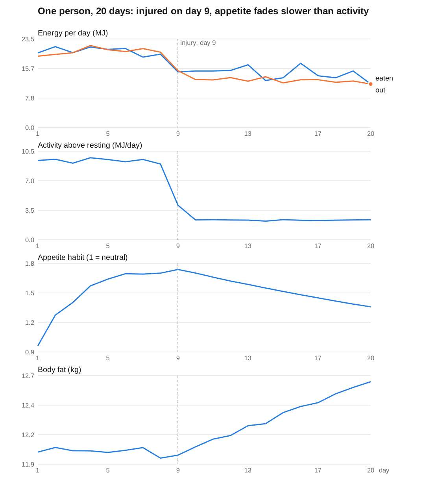

# Spike: the appetite habit

One person, 20 simulated days. Hard physical work on days 1–8, an injury on day 9 at 09:00 that leaves 15% of their muscle power, then quiet days with food always to hand. Spike 1 of brief 07 (AI brains): a body with metabolism by substance, utility choice, and nightly retrospection into a habit. Headless, integer-only, deterministic. Not the engine.

```bash
cargo test --release
cargo run --release --example appetite   # table, explained decisions, results/appetite.{csv,svg}
```



## What it shows

Activity drops at once after the injury; the appetite habit fades over weeks; the person eats more than they spend, and gains fat.

| | Days 1–8 | Days 10–14 | Days 16–20 |
|---|---|---|---|
| Activity above resting, kJ/day | 9,380 | 2,330 (25%) | 2,330 |
| Eaten / out, kJ/day | 20,290 / 20,210 | 14,860 / 12,880 | 14,110 / 12,250 |
| Appetite habit (1 = neutral) | 1.0 → 1.67 | 1.67 → 1.53 | 1.47 → 1.36 |

- Body fat: 11.94 kg on day 8 → 12.65 kg on day 20 (+0.70 kg). The morning weigh-in, 3-day mean: 73.41 → 73.80 kg (+0.39 kg; glycogen and its water swing it by ±0.3 kg a day).
- The lag is what gains the weight. The same run with no retrospection (appetite fixed at 1) gains 0.09 kg fat; with retrospection that has no lag (appetite jumps to its target each night) it loses 0.02 kg. Over seeds 1–12, the design gains 0.44–0.70 kg fat; both controls stay within ±0.15 kg.
- The energy books balance to the millijoule after every tick: stores at the start + food in = stores now + heat + work + waste.
- Two runs give the same state hash (`e2d4531153ef9201`, pinned in a test, so another machine that differs fails).
- Without the habit, the active person loses fat on days 1–8 (−0.33 kg): hunger alone doesn't keep up with hard work. The habit is what makes a worker eat enough.

Decisions explain themselves:

```
day  8 11:00  eat  (shortlist 2, appetite 1.67)
      work 0.442 = duty(0.46)=0.90 able(1.00)=1.00 fuelled(0.18)=0.50 ×w0.85 ×momentum
      eat  0.421 = hunger(1.00)=1.00 room(0.21)=0.21 awake(0.46)=1.00 ×w1.20 ×appetite1.67
day  9 09:00  rest reflex: pain: stop and rest
day 15 15:40  eat  (shortlist 1, appetite 1.50)
      eat  0.473 = hunger(0.40)=0.26 room(1.00)=1.00 awake(0.65)=1.00 ×w1.20 ×appetite1.50
      idle 0.402 = awake(0.65)=1.00 ×w0.35 ×momentum
```

Each consideration is `curve(input)=output`. Inputs are readings: glycogen fill, room in the stomach, time of day (0–1), capability left after injury.

## How it works

- **Time.** One body tick is 60 s (integer seconds). Metabolism changes over minutes, so that's honest; the engine's 20 Hz tick would be 1,200 of these. The brain chooses every 10 ticks; reflexes run every tick; retrospection runs once a night, at midnight.
- **Units.** Integer newtypes after `fv-core`'s `units.rs`: energy in mJ, power in mW, mass in mg, time in s, specific energy in kJ/kg (= mJ/mg, so mass × specific energy is exact), fractions and scores in Q16. Products go through `i128` and panic on overflow. Floats appear only in printing; a test scans the source to keep it that way.
- **Body** (`src/body.rs`). Lean 60 kg, fat 12 kg (as whole mg), glycogen as energy (capacity derived: 130 kJ per kg of lean mass, 7.8 MJ), a stomach (800 g) holding food by substance.
  - Bread: 11,000 kJ/kg, 2 g/min, 96% absorbed, 7% of that lost as heat digesting it. Meat: 8,500 kJ/kg, 1 g/min, 94%, 25%.
  - Resting power by Kleiber from current mass, with an integer `mass^0.75` (≈ 84 W at 72 kg). A heavier body burns more.
  - Muscle: 120 W sustainable, 25% efficient; the rest is heat. Injury caps it. Work asks 60 W of muscle.
  - Fat is released when glycogen is under half full and stored when it's over 80% (storing costs 15% extra, as heat). Fat tissue holds 32,000 kJ/kg.
- **Brain** (`src/brain.rs`).
  - Reflexes: pain → rest; full stomach → stop eating; empty glycogen → stop working.
  - Choosing: eat, rest, work, idle. Score = weight × product of curves (17-point integer tables) × 1.15 if already doing it. Eat is also multiplied by the appetite habit, which also scales the hunger reading. Options within 92% of the best form a shortlist, and `hash(seed, tick, creature, salt)` picks among them, weighted by score. Bread or meat is picked the same way, 60/40.
  - Experience: one entry per think interval (energy spent, energy eaten, how hungry, awake or not). Each morning's weigh-in is remembered.
  - Retrospection, nightly: demand = yesterday's spending ÷ a quiet day's (derived from the body: basal for 24 h, pottering for 16). Target appetite = 1 + (demand − 1) + 0.3 × (share of waking time hungry − 0.2) − 0.1 per kg gained over the week. The habit closes 35% of the gap a night when rising and 5% when fading. The day's log is then emptied: a day of experience becomes one number.

## What's faked

- Work is on offer every day; the injury doesn't heal. Time of day is read directly, not sensed from light. There are no beliefs: the brain reads the body's stores straight, and food is always there.
- Only energy is booked exactly. Mass isn't: food mass leaving as CO₂, water and waste isn't tracked, so the weigh-in is a reading (lean + fat + wet glycogen + stomach), not a balanced book.
- Hunger is glycogen only. There are no hormones, no leptin, no protein or fat needs, no thirst.
- The numbers that shape the result were tuned by hand until the story showed: the curves, action weights, the fade rate (5%/night, a half-life of about two weeks), the stomach size. The physical constants are textbook. The direction of the result is robust across seeds; its size depends on the fade rate.
- Daily intake is lumpy (10–17 MJ) because meals are 10-minute bouts that stop when the stomach is nearly full.

## What it suggests

- **Compiling down works at this size.** One integer per habit, nudged once a night from a day's log, is enough to give lag and weight gain, and the trace says why each choice was made. A real brain would hold one such number per consideration (a gain or a curve shift). Retrospection as "weight nudges toward a target, asymmetric rates" is a plausible first answer to the open question of what it computes.
- **Asymmetric learning is where the character comes from.** Habits that form fast and fade slow are what turn a body change into a lagging behaviour. Per-species and per-person rates are a cheap source of personality.
- **Knowledge representation.** Here the needs are readings of stores through curves, and the habit is a gain on one of them. Beliefs ("bread is food", "the pantry has food") would sit between senses and these considerations, each with a confidence; this spike skipped them, so it says nothing about teaching.
- **The yardstick must be derived.** A first version measured demand against resting metabolism alone, and every run overate even when sedentary. Measuring against a quiet day, derived from the body, fixed it. Thresholds derived, not set (4.2), matter inside brains too.
- **Threads.** The brain reads only the body's previous state and writes only its own state and one intent, and retrospection touches only the brain. Brains as their own pass (7.10) fit this shape cleanly. The per-tick brain cost here is tiny (the example runs the 20 days four times in about 16 ms), so a minute-rate body with a 10-minute think rate is cheap for distant creatures.
- **Body ticks can be coarse.** A body at one tick per minute keeps exact books, so far-away people could run their bodies at that rate (7.7).
